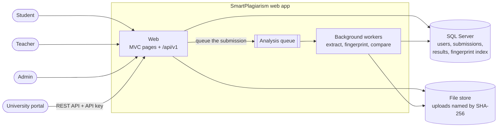
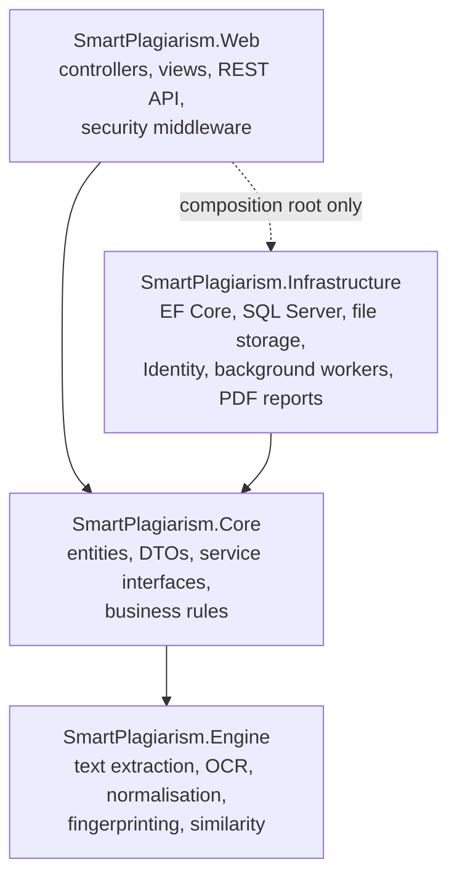
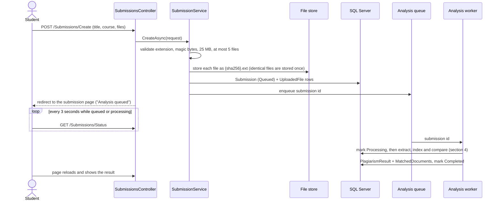
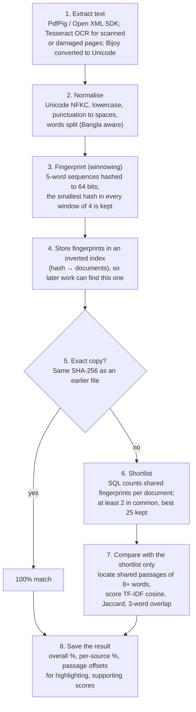

# Architecture

SmartPlagiarism checks academic reports and presentations (PDF, DOCX, PPTX, in
English and Bangla) against every earlier submission and an archive of past
years' work. It shows teachers exactly which passages match and where they came
from, and it serves a REST API so a university portal can submit work too.

This document covers what each part of the system is responsible for, how a
submission travels through the analysis, and why it was built this way.

---

## 1. The system at a glance

A page request never waits for an analysis. Uploading stores the files and puts
the submission on a queue. Background workers analyse it, and the page checks its
status every few seconds until the result is ready.

---

## 2. Layers and what each one is responsible for

| Project | Responsible for | Must not |
| --- | --- | --- |
| **Engine** | Reading text out of documents (including OCR and the legacy Bijoy Bangla encoding), normalising it, fingerprinting it, and scoring similarity between two documents. | Reference ASP.NET, EF Core or any other project. It is a pure library, tested on its own. |
| **Core** | The domain: entities with their state rules (a submission moves Queued → Processing → Completed/Failed), the DTOs that cross layers, and the interfaces every service implements. | Know how data is stored or shown. |
| **Infrastructure** | Everything that touches the outside world: the database (EF Core), files on disk, Identity, the background workers, the PDF report generator. It implements Core's interfaces. | Contain page logic. |
| **Web** | HTTP: controllers that bind input, call one service and return a view or JSON; the REST API; authentication, error pages, logging and security headers. | Contain business logic or touch the database directly. |

The arrows point inward. The Engine depends on nothing, so the hardest part of
the system can be tested in isolation, and it could be lifted into a command-line
tool or a separate service unchanged. A test (`EngineIsolationTests`) fails if
the Engine ever gains a reference to ASP.NET or EF Core.

Controllers are deliberately thin. For example, `ReviewController.Approve` binds
the form, calls `IReviewService.ApproveAsync` and redirects. Rules such as "a
rejection needs a comment" and "a teacher sees only their own department" live
in the service, so the web page and the REST API cannot disagree.

---

## 3. A submission, end to end

The queue is an in-memory channel, but the database is the source of truth. If
the server restarts, the workers find submissions still marked Queued or
Processing and pick them up again. A submission interrupted three times is
marked Failed rather than crashing the server on every start.

---

## 4. The analysis pipeline

Comparing a new submission with every document ever stored would get slower
with each year of the archive. Instead, each stage protects the next from work
it does not need to do:

**Why it scales.** Stage 6 is one indexed SQL query, however many documents are
stored. Stage 7, the expensive one, runs against at most 25 documents. A larger
archive barely changes the cost of analysing one submission.

**What the percentage means.** The headline figure is the share of the
submission's words that sit inside passages found in earlier work. A passage is
a run of at least 8 words matching in order, allowing small edits such as a
changed word. So the number is something a teacher can check: every percent is
highlighted text in the side-by-side viewer. Short stock phrases ("on the other
hand") can never add up to a score, which keeps two honest essays on the same
topic at 0%.

**Supporting evidence.** For reworded copying, which passages can miss, three
classic measures are shown beside each source: 3-word sequence overlap
(weight 0.50), TF-IDF cosine similarity (0.35) and Jaccard vocabulary overlap
(0.15), plus their weighted blend. They inform the teacher's judgement but are
not the headline.

**Fairness rules** (what is *not* counted):

- **The student's own earlier work** is listed, but not counted. A resubmission
  is not copying.
- **Text the whole class shares,** such as a cover page, the signed declaration
  or the assignment brief, is set aside and reported separately. "The whole
  class" means at least half of the other students in the course, and at least 5
  of them.
- **Later work is never a source.** Re-running an analysis on an original after
  someone copied it does not turn the original into the copy. Instead, the
  original's page lists the later submissions that matched it.

**When text cannot be read**, for example a scanned PDF with OCR unavailable, the
analysis fails with the reason. It never reports 0%, which would make an
unreadable file look perfectly original.

---

## 5. Security

| Concern | How it is handled |
| --- | --- |
| Who sees what | Three roles (Admin, Teacher, Student) plus one shared access rule: a student sees only their own submissions, a teacher only their department's, an API key only the submissions it created. Anything else returns 404, never 403, so nobody can probe which ids exist. |
| Student privacy | A student's report never names or quotes another student. It says "Another student's submission (CSE402)". |
| Uploads | Extension whitelist, file-signature (magic byte) check, 25 MB per file, 5 files. Files are stored outside the web root under their SHA-256 hash; the client's file name is kept only for display. |
| Forged requests (CSRF) | A global antiforgery filter covers every form post, and a test checks that every POST action is covered. The REST API is exempt: it accepts only an API key in a header, which a forged request cannot set. |
| Browser hardening | A strict Content-Security-Policy (no inline scripts or styles anywhere), `nosniff`, no framing, referrer and permissions policies, HTTPS redirection with HSTS, and no `Server` header. |
| API keys | 256 bits of randomness, stored only as a SHA-256 hash, compared in constant time, revocable, rate-limited per key. |
| Errors | Users see a friendly page or problem-details JSON with a reference number, never an exception message or stack trace. |
| Accountability | Sign-ins, reviews, re-analyses, admin changes and API key events are written to an audit log that admins can filter. |

---

## 6. Operations

- **Logging.** Serilog writes structured events to the console and to daily JSON
  log files (`App_Data/logs`, 30 days kept). Each request is one event with
  method, path, status, duration and user. The reference number on an error page
  is that request's trace id, so an administrator can find the full error in the
  log.
- **Engine versioning.** Every result records the engine version that produced
  it. When the scoring changes, archive texts are re-read and older results are
  re-analysed at the next start.
- **Resilience.** Two analyses run at once, so a long OCR job does not hold up
  ordinary submissions. Per-document limits on pages, unpacked size, image size
  and OCR time stop a hostile file from exhausting the server.

---

## 7. Key design decisions

| Decision | Alternative considered | Why this one |
| --- | --- | --- |
| Analyse in a background worker | Analyse inside the upload request | OCR of a long scanned PDF takes minutes and would time out the request. The queue also lets several uploads arrive while one is analysed. |
| In-process queue, database as the record | A message broker (RabbitMQ, Hangfire) | One server needs no broker. The database already records what is waiting, so nothing is lost on restart. The cost is that only one app instance can run (see limitations). |
| Extract text once and store it | Re-read files for every comparison | Comparing with 25 candidates would otherwise mean parsing (and possibly OCR-ing) 25 documents each time. |
| Winnowing fingerprints in an SQL inverted index | Compare every pair of documents | Turns "compare with everything" into one indexed query. Winnowing guarantees that any passage of 8 or more words two documents share leaves a fingerprint in common, and requiring two catches a single copied paragraph while ignoring a stray hash collision. |
| Headline score = share of text in matched passages | The weighted blend of the classic measures | A teacher can verify it by looking at the highlights. Blended similarity answers a different question: "how alike are these documents", not "how much was copied". |
| Services use EF Core's DbContext directly | A generic repository layer | The DbContext already is a repository and unit of work. Queries project straight into DTOs, which a generic repository would hide. |
| One web project for pages and API | A separate API project | Same services and the same access rule, with no duplicated plumbing. The API is versioned under `/api/v1`. |
| DataAnnotations for input validation | FluentValidation | Already used on every model. It gives client-side validation for free, and the services re-check every rule, since both the web and the API reach them. |

---

## 8. Known limitations

- **One app instance.** The queue lives in the web server's memory and uploads on
  its disk, so the app cannot yet be spread across several servers.
- **No internet sources.** Work is compared with the university's own
  submissions and archive only, not with web pages or published papers.
- **Lexical, not semantic.** Heavy paraphrasing and translation (Bangla to
  English, say) can slip past. The measures compare words, not meaning.
- **No corpus-wide word weights yet.** The TF-IDF measure weights every word
  equally until document frequencies across the corpus are kept, so for now it
  behaves as a plain term-frequency cosine.
- **OCR quality varies.** Scanned and damaged Bangla pages depend on Tesseract's
  accuracy, and OCR is capped at 30 minutes per document.
- **Prose only.** Source code, spreadsheets and images inside files are not
  compared as such (text in pictures is read by OCR).
- **Accounts are local.** There is no sign-in through the university's identity
  provider and no self-service password reset. Admins create accounts.

---

## 9. Future work

1. **Meaning, not just words.** Add multilingual sentence embeddings (LaBSE or
   multilingual-E5, for example) as a second shortlist and score beside the
   fingerprints. That would catch paraphrasing and Bangla ↔ English translation,
   the main gap above.
2. **Sources beyond the university.** Check against the web and open-access
   repositories (CORE, arXiv, national thesis archives). The data model already
   allows a matched source that is not an uploaded file.
3. **Scale out.** Move the queue to a durable broker (or Hangfire on SQL Server)
   and the files to blob storage, so several web servers and workers can run
   behind a load balancer, packaged with Docker Compose.
4. **Fit into the university.** Single sign-on through the university's identity
   provider (OpenID Connect or SAML), LTI 1.3 so submissions arrive straight
   from Moodle or Google Classroom, and webhooks to tell the portal a result is
   ready instead of it polling.
5. **Measure and tune.** Build a labelled corpus of Bangla and English cases
   (the PAN plagiarism corpus covers English) to report precision and recall,
   tune the thresholds (8-word passages, the 25-document shortlist) on evidence,
   and keep corpus-wide word frequencies for true TF-IDF.
