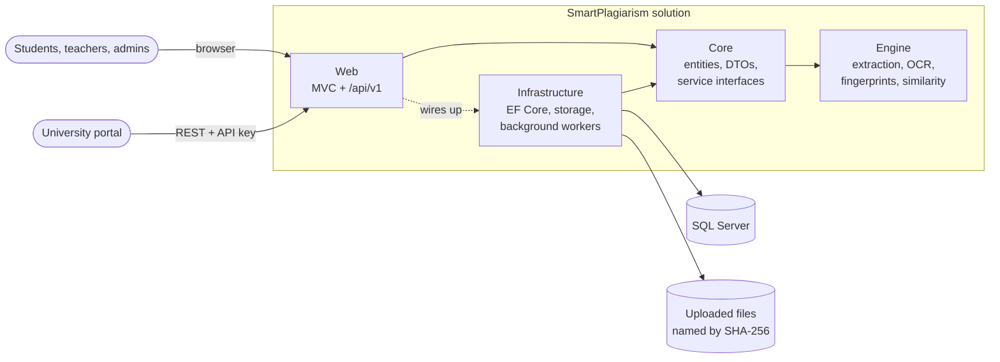
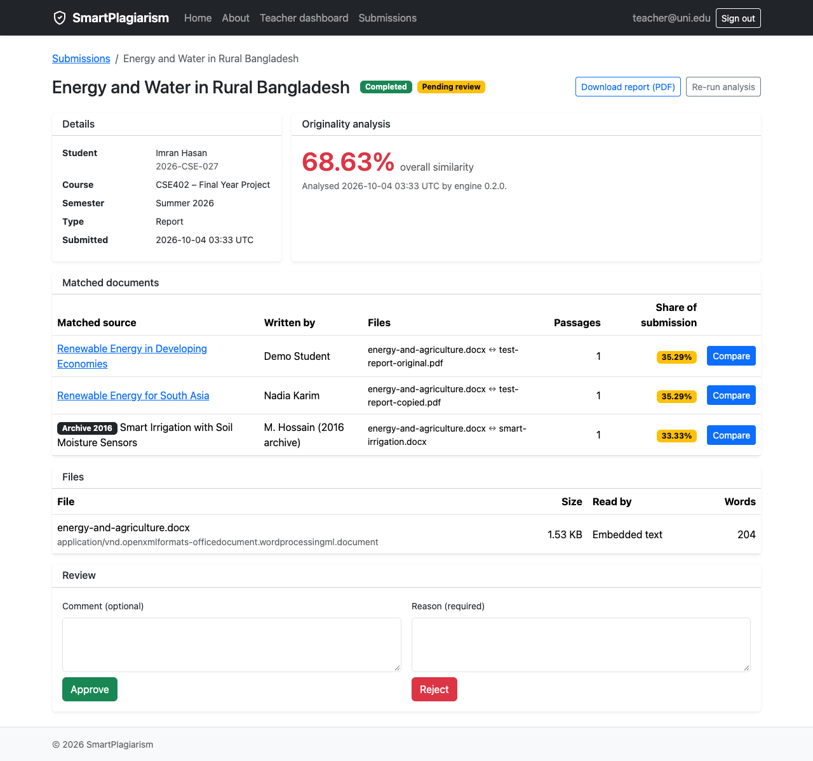
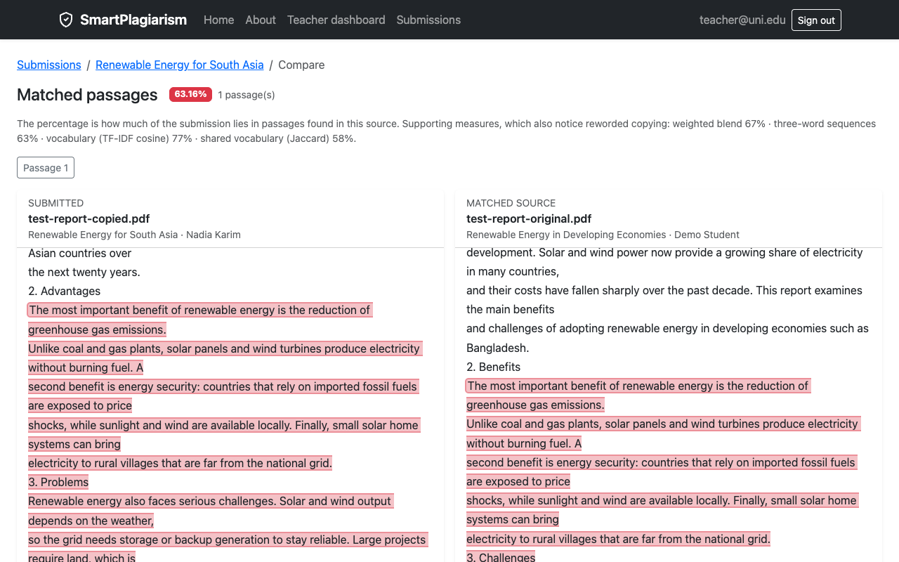
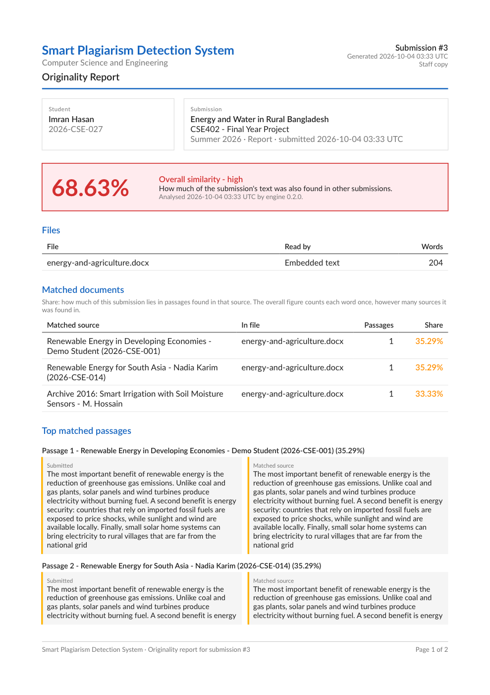
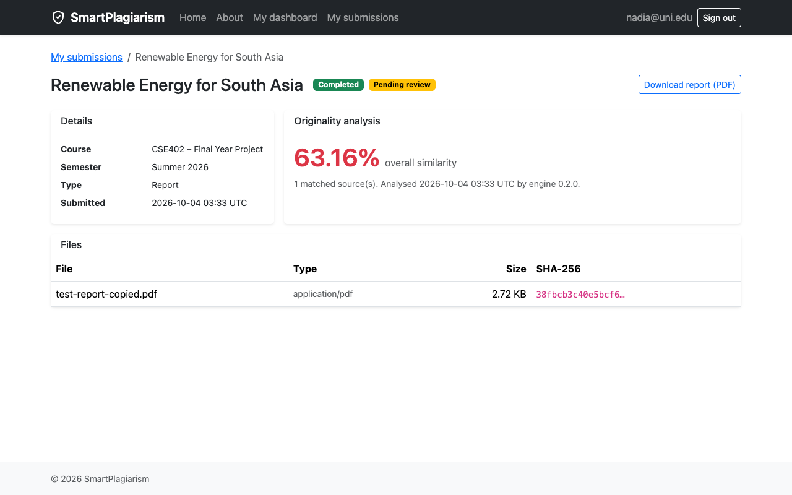
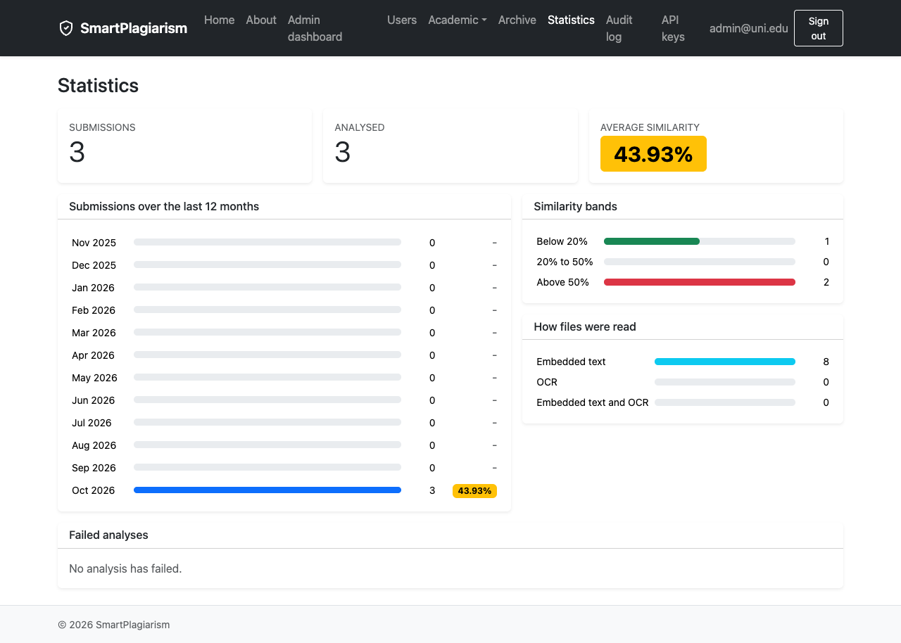
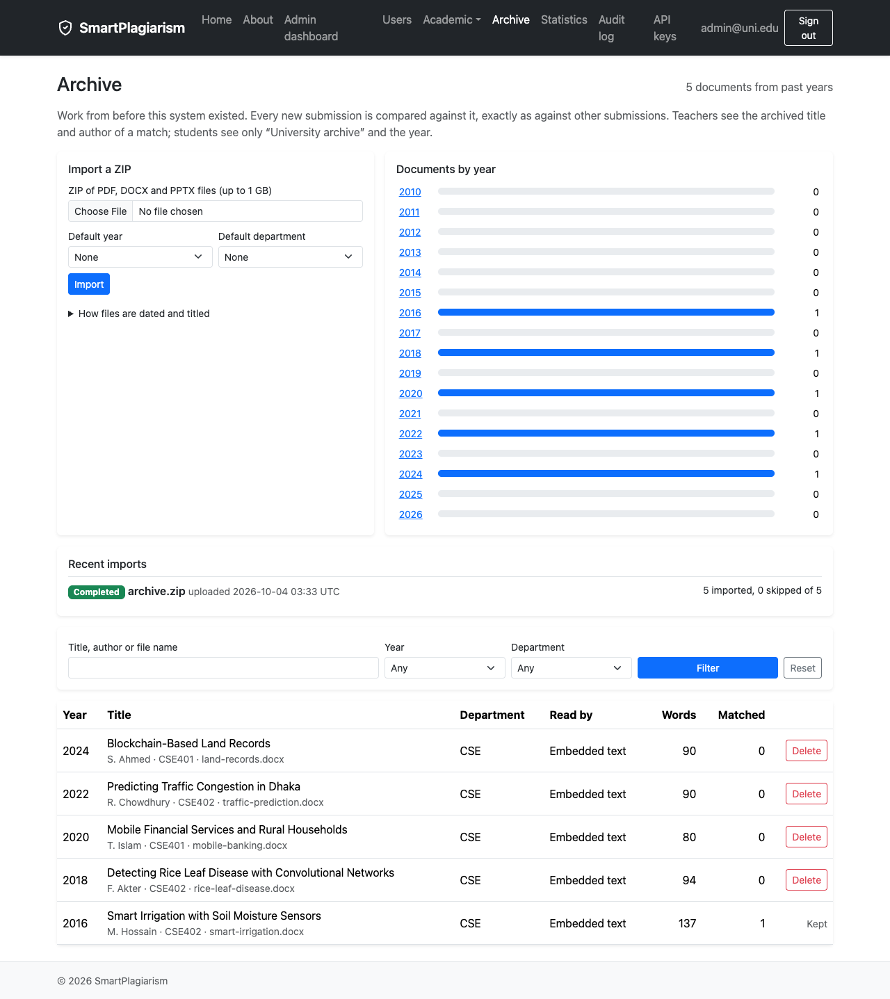

# SmartPlagiarism

A plagiarism detection system for academic work. Students submit reports and
presentations (PDF, DOCX, PPTX, in English or Bangla). Each submission is
checked against every earlier submission and an archive of past years' work.
Teachers then see exactly which passages match and where they came from. A
versioned REST API lets a university portal submit work and fetch results too.

Built as a final-year CSE project with ASP.NET Core MVC on .NET 10, SQL Server
and a standalone similarity engine.

- **[SETUP.md](SETUP.md)**: step-by-step setup on Windows, macOS and Linux,
  including OCR for Bangla and scanned documents.
- **[ARCHITECTURE.md](ARCHITECTURE.md)**: the layers, the analysis pipeline and
  the design decisions behind them.

---

## What it does

| Role | Can |
| --- | --- |
| **Student** | Submit up to five files (25 MB each); watch the analysis status update live; see the similarity result; download an originality report that never names or quotes other students. |
| **Teacher** | List their department's submissions with filters and sorting; open the side-by-side viewer with matched passages highlighted in both documents; approve, or reject with a comment; re-run an analysis; download the full staff report. |
| **Admin** | Manage accounts, departments, courses and semesters; import past years' work into the archive from a ZIP; view system statistics and failed analyses; search the audit log; issue and revoke API keys. |
| **University portal** | Upload submissions, poll their status and download reports over `/api/v1`, authenticated by API key and rate-limited per key. |

Under the hood:

- **Text extraction** from PDF, DOCX and PPTX, with Tesseract OCR for scanned
  pages, damaged Bangla text layers and text in pictures. Documents in the
  legacy Bijoy (SutonnyMJ) encoding are converted to Unicode.
- **Winnowing fingerprints** in an SQL inverted index shortlist the few documents
  worth comparing, so analysis time stays flat as the archive grows.
- **Passage-level matching.** The score is the share of the submission inside
  passages found elsewhere, so every percent is highlighted text a teacher can
  check. TF-IDF cosine, Jaccard and n-gram overlap are shown beside each source
  as supporting evidence.
- **Fairness rules.** A student's own earlier work is listed but not counted,
  text the whole class shares (cover pages, declarations) is set aside, and work
  is only compared with what existed before it.

---

## Architecture



Dependencies point inward. The Engine references no other project and no web
or database library, so it is tested on its own. Analysis never runs inside a
web request: uploads are queued, and background workers extract, fingerprint
and compare them. See [ARCHITECTURE.md](ARCHITECTURE.md) for the full picture.

| Project | Purpose |
| --- | --- |
| `src/SmartPlagiarism.Web` | MVC pages, the `/api/v1` REST API, error handling, logging, security headers |
| `src/SmartPlagiarism.Core` | Entities, enums, DTOs, service interfaces, business rules |
| `src/SmartPlagiarism.Infrastructure` | EF Core and migrations, Identity, file storage, background workers, PDF reports |
| `src/SmartPlagiarism.Engine` | The plagiarism engine: extraction, OCR, normalisation, fingerprinting, similarity |
| `tests/SmartPlagiarism.Tests` | xUnit tests for the engine, the services and the running web app |

## Tech stack

| Area | Choice |
| --- | --- |
| Web | ASP.NET Core MVC (.NET 10), Razor views, Bootstrap 5 |
| Data | SQL Server, Entity Framework Core (code-first migrations) |
| Identity | ASP.NET Core Identity with Admin, Teacher and Student roles; API keys for the REST API |
| Documents | PdfPig, Open XML SDK, PDFium (page rendering), Tesseract OCR |
| Reports | QuestPDF, with Noto Sans Bengali for Bangla text |
| Logging | Serilog: console and daily JSON log files |
| API docs | OpenAPI with Swagger UI (Development only) |
| Tests | xUnit, FluentAssertions, WebApplicationFactory, SQLite |

---

## Getting started

You need the [.NET 10 SDK](https://dotnet.microsoft.com/download) and SQL
Server. On macOS and Linux, run SQL Server in Docker:

```bash
docker run -d --name smartplagiarism-sql \
  -e ACCEPT_EULA=Y -e MSSQL_SA_PASSWORD='SmartPlag#2026' \
  -p 1433:1433 mcr.microsoft.com/mssql/server:2022-latest
```

Then build, test and run:

```bash
dotnet build
dotnet test
dotnet run --project src/SmartPlagiarism.Web
```

Open <http://localhost:5028>. In Development the app applies migrations and
seeds demo data on startup, so there is nothing else to set up. Windows users can
use LocalDB instead of Docker; OCR is optional and needs Tesseract. Both are
covered in [SETUP.md](SETUP.md).

### Demo accounts

| Role | Email | Password |
| --- | --- | --- |
| Admin | `admin@uni.edu` | `Admin#123` |
| Teacher | `teacher@uni.edu` | `Teacher#123` |
| Student | `student@uni.edu` | `Student#123` |

The seed also creates the CSE department, two courses (CSE401 Software
Engineering, CSE402 Final Year Project) and a semester. The demo accounts exist
only in Development. In any other environment, accounts are created by an admin.

### A five-minute tour

1. Sign in as the **student** and submit a PDF or DOCX report under CSE402. The
   status changes from Queued to Completed on its own.
2. As the **admin**, create a second student under **Users** and sign in as them.
   Submit a copy of the first report with some edits.
3. Sign in as the **teacher**, open **Submissions**, choose the copy and click
   **Compare** to see the shared passages highlighted side by side. Approve or
   reject it.
4. Back as the **admin**, look at **Statistics** and the **Audit log**.

---

## Tests

```bash
dotnet test
```

The suite covers four areas:

- **The engine:** extraction from generated PDF, DOCX and PPTX fixtures,
  Bangla and Bijoy text, normalisation, winnowing and similarity scoring.
- **The services:** run against SQLite.
- **The running app:** integration tests over HTTP for the REST API, error pages,
  structured logs, security headers and the antiforgery check on every form post.
- **Architecture:** a test that keeps the Engine free of web and database
  references.

## REST API

Create a key under **Admin > API keys**, then send it in the `X-Api-Key` header:

| Method | Path | Returns |
| --- | --- | --- |
| `POST` | `/api/v1/submissions` | 202 and a `Location` to poll; analysis runs in the background |
| `GET` | `/api/v1/submissions/{id}` | Status, and the similarity result once completed |
| `GET` | `/api/v1/submissions/{id}/report` | The originality report PDF |
| `GET` | `/api/v1/health` | Liveness, no key needed |

Errors come back as `application/problem+json`. In Development the full contract
is at `/swagger`. [SETUP.md](SETUP.md#6-rest-api-portal-integration) has a
`curl` example.

## Logs and errors

Logs go to the console and to `src/SmartPlagiarism.Web/App_Data/logs`, one JSON
file per day with one event per line, kept for 30 days. Levels are set under
`Serilog` in `appsettings.json`, and the file location under `LogFile`.

When something fails, users see a plain error page with a **Reference** (the
request's trace id) instead of any technical detail. To find what happened,
search the log for it:

```bash
grep <reference> src/SmartPlagiarism.Web/App_Data/logs/*.json
```

## Main settings

| Setting (`appsettings.json`) | Default | Meaning |
| --- | --- | --- |
| `ConnectionStrings:DefaultConnection` | in `appsettings.Development.json` | SQL Server connection |
| `FileStorage:RootPath` | `App_Data/uploads` | Where uploaded files are kept |
| `Ocr:Enabled`, `Ocr:Language` | `true`, `ben+eng` | OCR for scanned or damaged pages |
| `Analysis:Workers` | `2` | Submissions analysed at once |
| `Api:UploadsPerMinute` | `10` | Upload limit per API key |
| `Extraction:*` | see `ExtractionLimits` | Page, size and OCR-time limits per document |

---

## Screenshots

From a demo run with fictional students and archive documents.

**Teacher: a submission matched against two classmates and a 2016 archive report.**
The overall figure counts each word once, however many sources it was found in.



**Teacher: the side-by-side match viewer.** Clicking a passage on either side
scrolls the other side to it.



**The originality report (staff copy).** The student's copy leaves out other
students' names and text.



**Student: the result of a submission.**



**Admin: system statistics.**



**Admin: the archive of past years' work, filled from a ZIP.**



---

## More

- [CLAUDE.md](CLAUDE.md): the architecture and workflow rules the code follows.
- [THIRD-PARTY-NOTICES.md](THIRD-PARTY-NOTICES.md): bundled fonts and adapted code.
